# RipScout BBS

**BBS software drawn entirely in RIPscrip 1.54 graphics.** Every screen is vector
graphics with clickable buttons, from the welcome screen and the signup wizard to the full Sysop
Admin system. It's built to show off RIPscrip as far as it goes, and made for
[DialComm](https://github.com/Dialsoft/dialcomm-releases).

*By Dialsoft LLC, Wharton NJ.* Dialsoft's own showcase board, **BMX BBS**, runs RipScout with the BMX theme pack.

| Generic theme pack (recommended) | BMX theme pack |
|---|---|
| 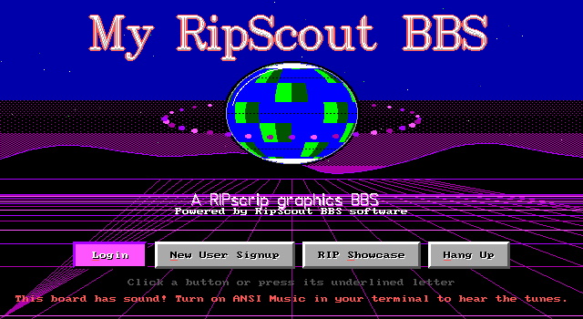 | 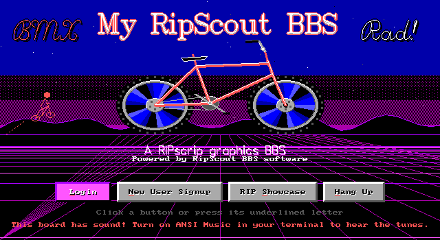 |

## Download

Get **RipscoutBBS.exe** from the [latest release](https://github.com/Dialsoft/ripscoutbbs-releases/releases/latest).
It's one Windows EXE (about 8.5 MB) with nothing to install.

## Features

- **Telnet BBS** for up to 250 callers at once, with automatic RIPscrip detection
- **Modern signup wizard**: a step tracker, real input boxes, a live "name available" check and a live password-strength meter
- **Message boards** with clickable lists, quoted replies and a word-wrapping editor
- **Teleconference**: real-time multi-node chat
- **RIP Showcase**: seven demo pages covering fonts, patterns, curves, every button style, pick lists, palette-cycling and sprite animation
- **Sysop Admin, all in RIP**: users, board settings, message areas, nodes and broadcasts, statistics, news and rules
- **Every setting takes effect live, with no restart**, including the telnet port
- Six color themes each caller can choose
- **Theme packs**: choose how your board looks during setup and switch any time, live. **Generic** (recommended: a turning globe in a ring of chasing lights, with tech and retro-computing news) or **BMX** (a neon BMX race bike with spinning mag wheels, with BMX news). Every pack has the same menus, games and features
- **First-run setup** in the Control Panel: board name, sysop, location, tagline, port and theme pack in one screen
- **Games**: *Dirt Jumper* (side-scroller), *Cone Blaster* (shooter), *Spoke Breaker* (brick breaker), *Block Drop* (falling blocks), *Turbo Lap* (3-D arcade road racer), *Word Wheelie* (word game with Word Duels) and *Solitaire*, with high score tables
- **Email** between members, and **notifications on any screen** for new mail, game invites, pages and broadcasts. Click one to open it
- **File Libraries**: browse, search, download and upload files with built-in **Zmodem** (DialComm starts receiving by itself)
- **Echomail**: share message areas with **fsxNet, FidoNet** and other FTN networks through a built-in binkp mailer, set up in RIP or the Control Panel
- **Usenet newsgroups**: each newsgroup becomes a message area; read and post over NNTP (with encryption and login)
- **Two-factor sign-in** with Google Authenticator: the setup QR code is drawn right in RIP, with backup codes, a sysop reset tool and a configurable name in the app
- **Sound**: RIPscrip's own sound effects in the games and notifications, ANSI music jingles, and a Sound page in the RIP Showcase
- **Stats**: BBS Stats with charts and leaderboards, and My Stats for every caller (time online, words typed, transfers, streaks, badges)
- **Audit trail** of logins, security events, sysop actions and every settings change, in RIP and on the Control Panel's Audit tab
- **Finger server**: `finger @yourboard` shows who's on; `finger name@yourboard` shows a member and their plan
- **Content Editor in RIP**: edit every menu (items, icons, modules, submenus), draw pixel icons, swap backgrounds, all live
- **Linked Teleconference**: link boards into one chat room, with line numbers and private messages across boards
- **Tray icon and Control Panel**: no console window. The tray icon opens a Control Panel with live stats, callers, users, settings and the log
- **BMX Newsmap**: BMX news as a RIP treemap, with a **QR code** on every story to open it on your phone
- **Updates on your terms**: Ask me first (the default: download, verify, notify, show what changes, install when you say), Automatic, or Off

| | |
|---|---|
|  | 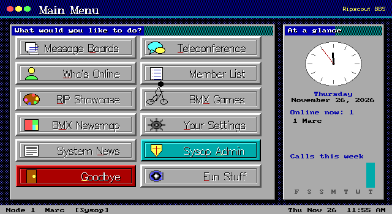 |
|  |  |

| 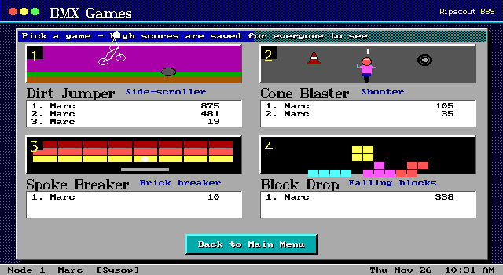 | 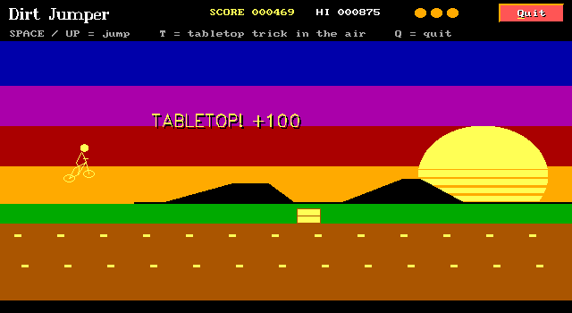 |
|---|---|
| 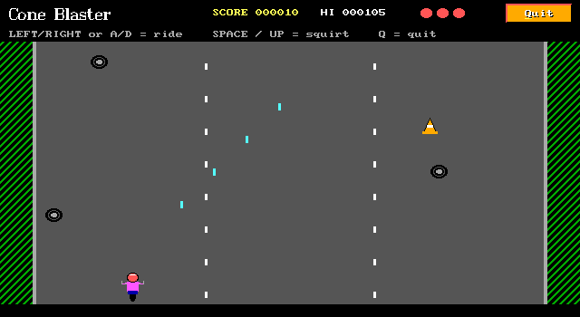 | 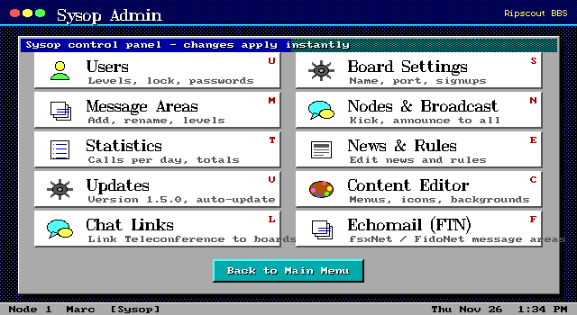 |
|  |  |
|  |  |
| 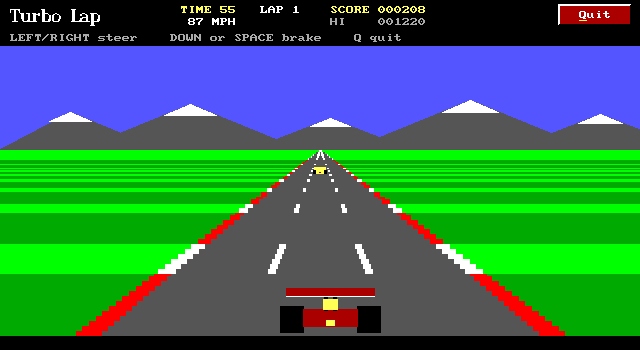 | 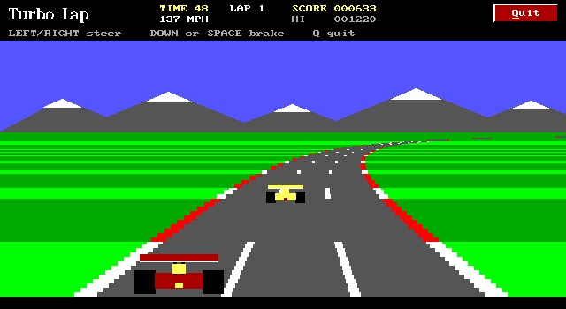 |
| 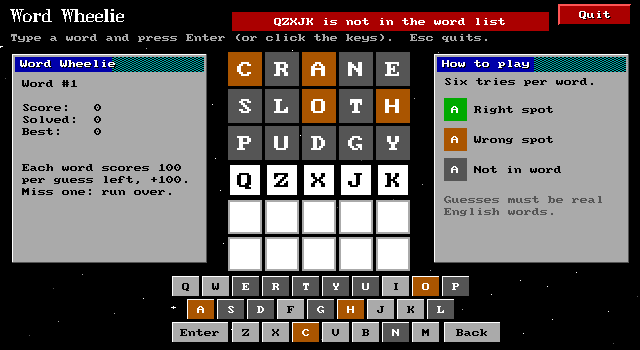 | 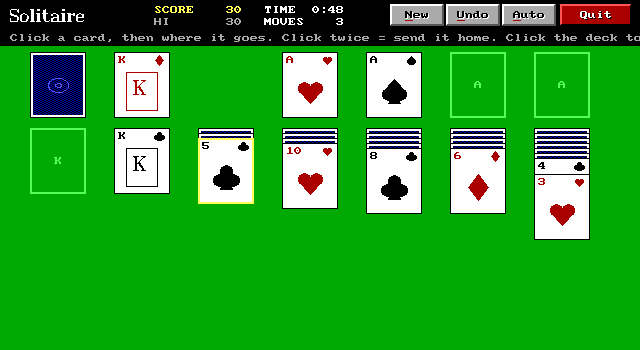 |

| 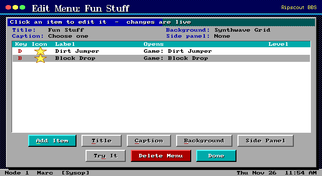 | 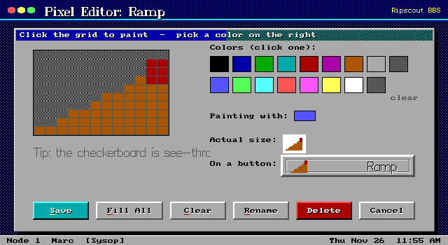 |
| 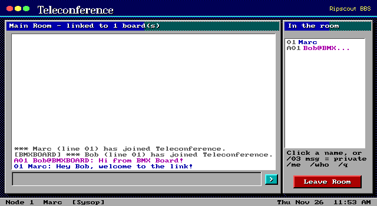 | 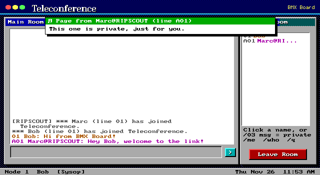 |
| 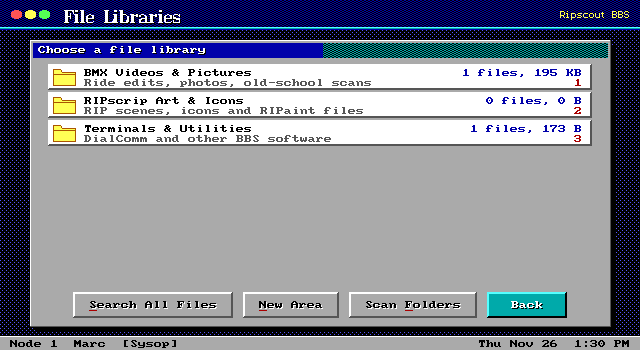 | 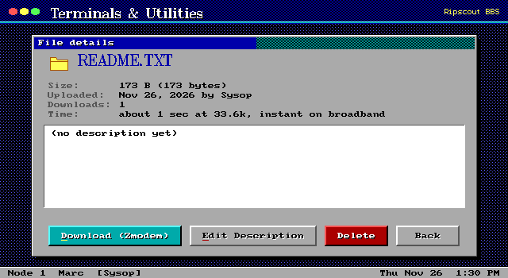 |
| 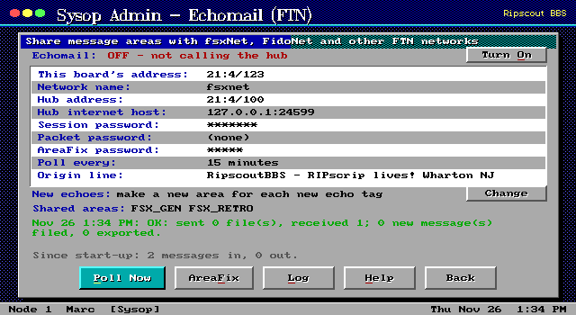 | 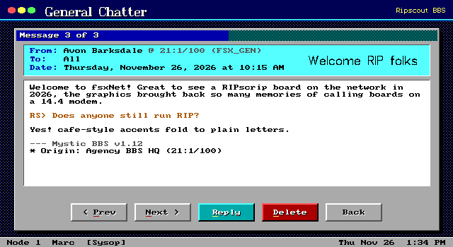 |
| 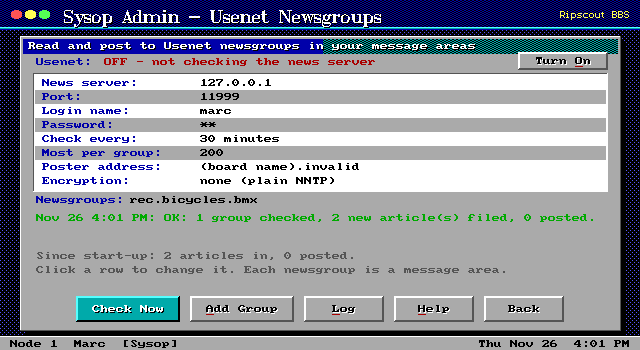 | 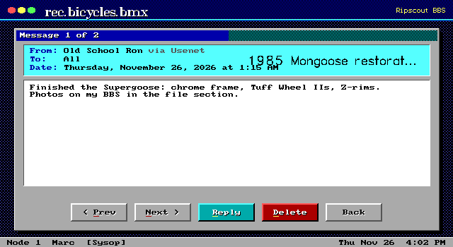 |
| 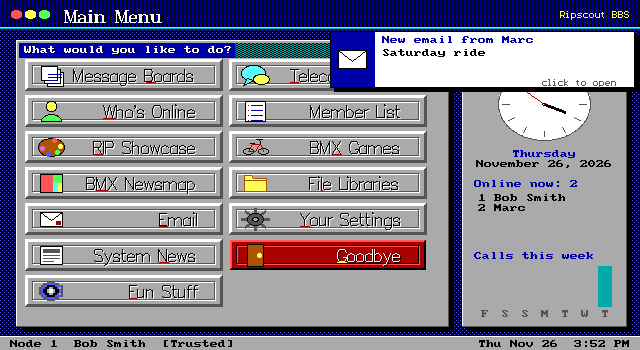 | 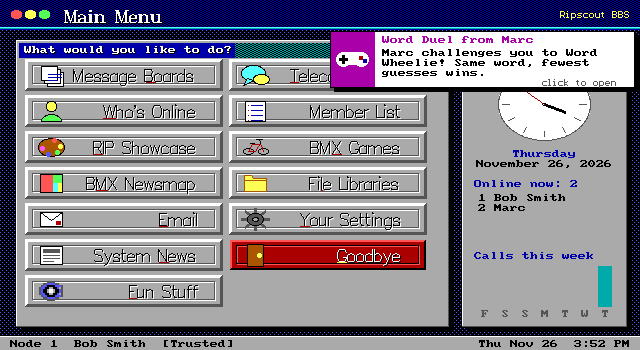 |
| 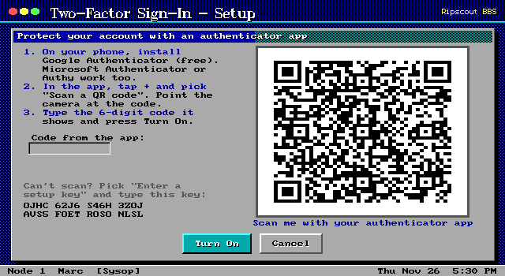 | 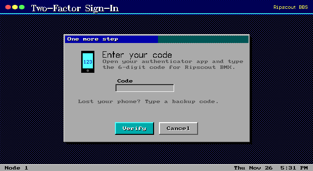 |
| 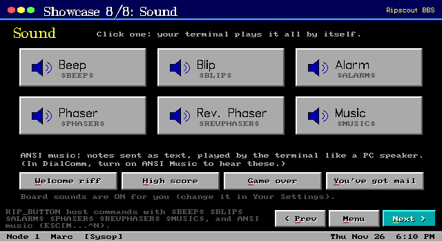 | 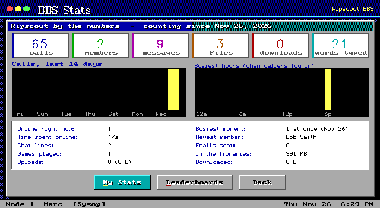 |
| 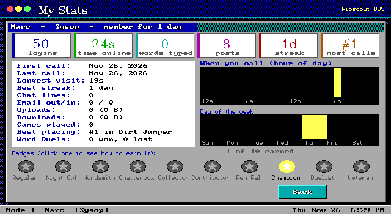 | 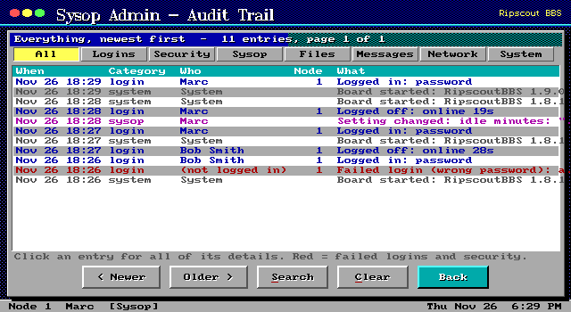 |

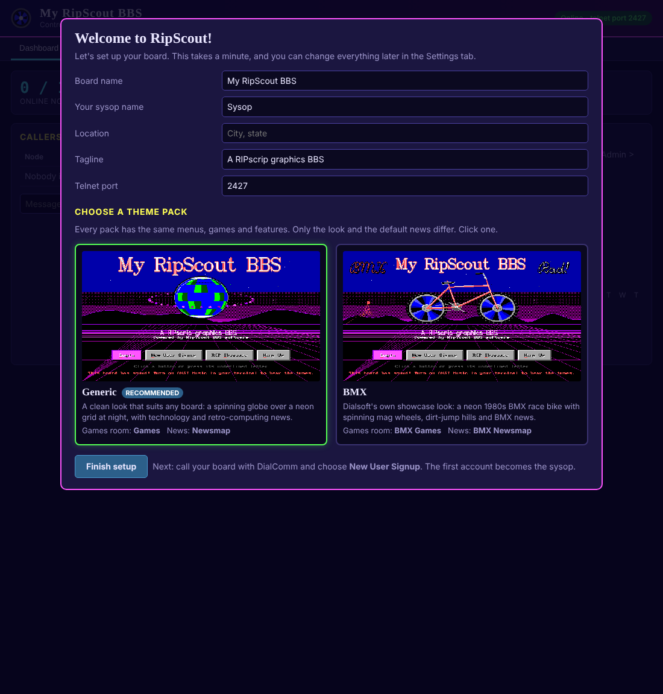

## Quick start

1. Put `RipscoutBBS.exe` in its own folder (for example `C:\RipscoutBBS`) and double-click it. The Control Panel opens and the wheel icon appears in the system tray.
2. Allow the port in Windows Firewall (Command Prompt as Administrator):
   `netsh advfirewall firewall add rule name="RipscoutBBS" dir=in action=allow protocol=TCP localport=23`
3. In DialComm, add a Telnet entry for the server with **Emulation: RIPscrip**.
4. Call in and choose **New User Signup**. **The first account becomes the Sysop.**

The full manual is the **[Sysop Guide](SYSOP-GUIDE.md)**.

> Hosting note: RipscoutBBS has to run on a Windows PC or server. Web hosts like Netlify can't keep
> telnet connections open.
