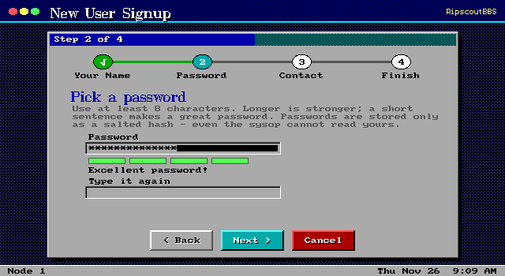
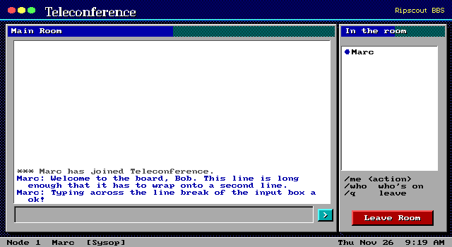
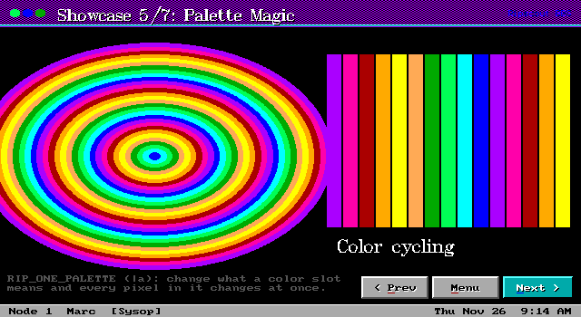
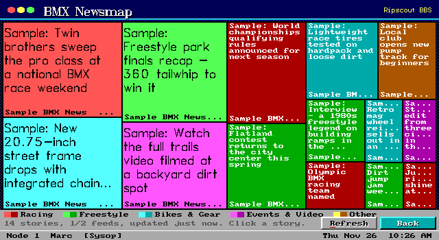
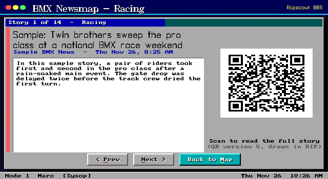
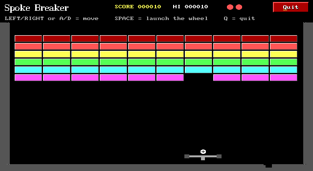
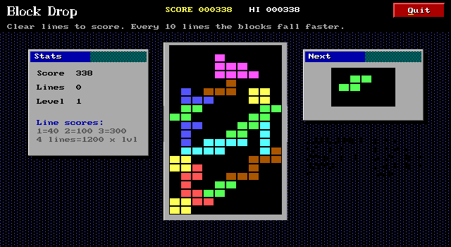
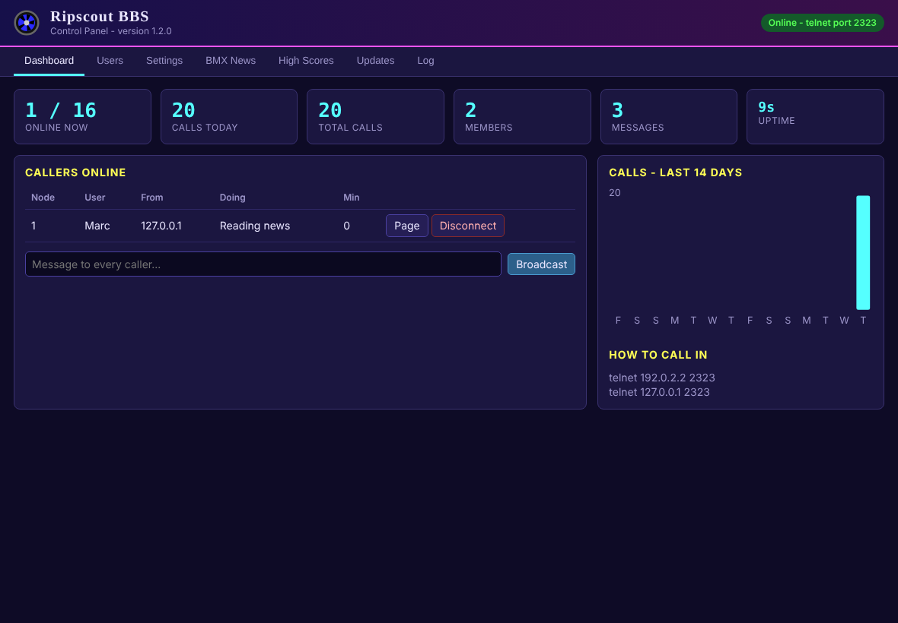

# RipscoutBBS

**A bulletin board system drawn entirely in RIPscrip 1.54 graphics.** Every screen is vector
graphics with clickable buttons, from the welcome screen and the signup wizard to the full Sysop
Admin system. It's built to show off RIPscrip as far as it goes, and made for
[DialComm](https://github.com/Dialsoft/dialcomm-releases).

*By Dialsoft LLC, Wharton NJ.*

## Download

Get **RipscoutBBS.exe** from the [latest release](https://github.com/Dialsoft/ripscoutbbs-releases/releases/latest).
It's one Windows EXE (about 3.7 MB) with nothing to install.

## Features

- **Telnet BBS** for up to 250 callers at once, with automatic RIPscrip detection
- **Modern signup wizard**: a step tracker, real input boxes, a live "name available" check and a live password-strength meter
- **Message boards** with clickable lists, quoted replies and a word-wrapping editor
- **Teleconference**: real-time multi-node chat
- **RIP Showcase**: seven demo pages covering fonts, patterns, curves, every button style, pick lists, palette-cycling and sprite animation
- **Sysop Admin, all in RIP**: users, board settings, message areas, nodes and broadcasts, statistics, news and rules
- **Every setting takes effect live, with no restart**, including the telnet port
- Six color themes each caller can choose
- **BMX theme**: a spinning 5-spoke mag wheel on the welcome screen
- **BMX Games**: *Dirt Jumper* (side-scroller), *Cone Blaster* (shooter), *Spoke Breaker* (brick breaker) and *Block Drop* (falling blocks), with high score tables
- **Tray icon and Control Panel**: no console window. The tray icon opens a Control Panel with live stats, callers, users, settings and the log
- **BMX Newsmap**: BMX news as a RIP treemap, with a **QR code** on every story to open it on your phone
- **Auto-update**: checks this page every 6 hours, verifies each download, and installs only when nobody is online

| | |
|---|---|
|  |  |
|  |  |

|  |  |
|---|---|
|  |  |
|  |  |
|  |  |

## Quick start

1. Put `RipscoutBBS.exe` in its own folder (for example `C:\RipscoutBBS`) and double-click it. The Control Panel opens and the wheel icon appears in the system tray.
2. Allow the port in Windows Firewall (Command Prompt as Administrator):
   `netsh advfirewall firewall add rule name="RipscoutBBS" dir=in action=allow protocol=TCP localport=23`
3. In DialComm, add a Telnet entry for the server with **Emulation: RIPscrip**.
4. Call in and choose **New User Signup**. **The first account becomes the Sysop.**

The full manual is the **[Sysop Guide](SYSOP-GUIDE.md)**.

> Hosting note: RipscoutBBS has to run on a Windows PC or server. Web hosts like Netlify can't keep
> telnet connections open.
